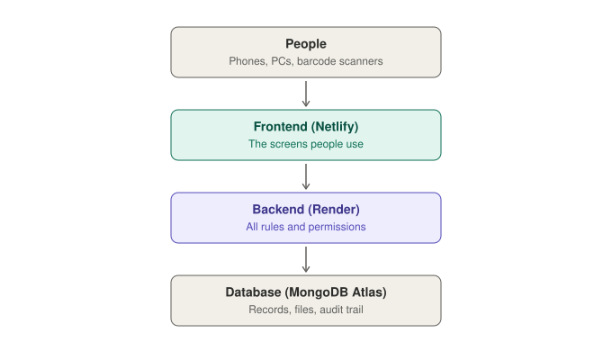
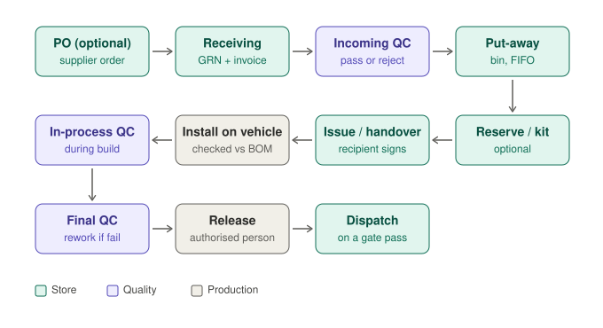
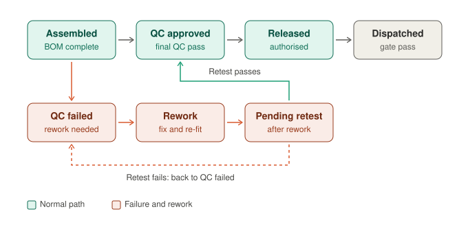

# AltEner Solutions Inventory Management System
**Backend API · Version 1.0.0**

This document is written for whoever looks after this system next. It explains what the system is, how it works, where everything is hosted, and how to run and recover it, in plain language. You do not need to know the original developer.

---

## 1. What this system is

A web application that controls **material from purchase to finished vehicle**:

* what was received, from which supplier, on which invoice;
* whether it passed quality control (QC) before anyone could use it;
* exactly where it is stored, and who moved it;
* which component went into which vehicle (and the reverse: which vehicles contain a given component);
* whether a vehicle passed final QC before it was released and dispatched.

It has three parts. **This repository is only the backend (the server and the database logic).**

| Part | What it does | Where it runs |
|---|---|---|
| Backend (this repository) | All rules, the database logic and the API. Every important rule is enforced here, never only on the screen. | Render (Node.js) |
| Frontend (separate repository / folder) | The screens people use, installable on phones as an app. | Netlify |
| Database | All records, uploaded invoice and QC files, and the audit log. | MongoDB Atlas |



---

## 2. Ownership and handover (read this first when taking over)

Fill this table in once and keep it current. **Accounts must belong to the company, never to one person.**

| Item | Value |
|---|---|
| GitHub repository (backend) | https://github.com/Altenersolutions/aspl-wms-backend-staging |
| GitHub repository (frontend) | https://app.netlify.com/projects/altenersolutions-inventory-system/overview |
| Render service name / URL | https://aspl-wms-backend-staging.onrender.com |
| Netlify site name / URL | https://altenersolutions-inventory-system.netlify.app |
| MongoDB Atlas project / cluster | -- |
| Company email that owns these accounts | -- |
| Current system owner (name, role) | Saivinayak Pawar, Trainee, with "system reference: RND-7" |
| Date of last backup tested | -- |

**When a maintainer or administrator leaves, do all of this the same day:**
1. Transfer ownership (not just access) of GitHub, Render, Netlify and Atlas to a company account.
2. Change the Atlas database password, then update `MONGO_URI` in Render.
3. Change `JWT_SECRET` in Render (everyone is signed out once, which is fine).
4. Deactivate the person's user in the application (Users screen) and change the password of any shared admin login.
5. Make sure at least two people hold an **admin** login.
6. Take and test a backup (section 11).

**Secrets are never stored in the code or in this repository.** They exist only in Render's Environment page (and Atlas). If a secret is ever pasted into a chat, email or screenshot, change it.

---

## 3. Deploying on Render

* Build command: `npm install --omit=dev`
* Start command: `npm start`
* Health check path: `/api/health` (also `GET /api/version` shows the running version)

| Environment variable | Required | What to put |
|---|---|---|
| `NODE_ENV` | yes | `production` |
| `NODE_VERSION` | yes | `20` |
| `JWT_SECRET` | yes | Long random text, **at least 32 characters**. In production the server refuses to start with a shorter one or with the example value. |
| `MONGO_URI` | yes | Atlas connection string ending `/inventory?retryWrites=true&w=majority` |
| `CORS_ORIGINS` | yes | The Netlify site address, no trailing slash. |
| `BOOTSTRAP_ADMIN_EMAIL`, `BOOTSTRAP_ADMIN_PASSWORD` | first start only | Creates the first admin while no users exist. Remove them afterwards. |
| `SEED_ON_START` | no | Leave `false`. (Development only: creates demo locations and parts, never BOMs or vehicles. Ignored in production.) |
| `SEED_DEMO_USERS` | no | Leave `false`. |
| `COMPANY_NAME` | no | Printed on the Gate Pass header. |
| `HANDOVER_WITNESS_REQUIRED` | no | `true` = if someone answers a material handover on behalf of the recipient, a named witness is also required. |

The free Render plan sleeps when idle, so the first request after a quiet period can take about a minute. That is normal.

---

## 4. The inventory concept

### 4.1 Core ideas
* **Part** (the production-facing identity) is separate from the **supplier**. The company's own part number is what everyone uses; supplier names and numbers are recorded alongside, never instead.
* **Inventory class** says what the stock *is*: **General** (consumables and tools: receive, store, issue, return, no QC or BOM), **Production** (goes into vehicles: full QC, FIFO, BOM and traceability rules) or **Development** (engineering parts: draft → review → approved → active).
* **Tracking type** says how it is counted: **Serial** (each unit has its own serial number), **Batch** (a lot with a batch number) or **Quantity** (just a count).
* **Location** is where stock physically is: receiving area, QC hold, reject area, racks and bins, work-in-progress (WIP), in transit, a vehicle. Stock always sits in a location; it moves only through a recorded transaction.
* **Ledger** (inventory transactions): every receipt, issue, return, transfer, installation, removal and adjustment is written as a transaction with who, when and why. Stock balances are always consistent with the ledger and can be checked with `npm run reconcile`. History is never deleted.
* **Status** of material: pending incoming QC → approved → (issued / installed) or hold / rejected / rework. Only **approved** material can be issued, handed over or installed.
* **Revisions**: parts and BOMs carry revisions. A vehicle records the exact BOM revision and part revision used when each component was installed.
* **Audit trail**: every important action and every override is recorded with the user and the reason.

### 4.2 The normal flow
```
Purchase order (optional)
   -> Receiving (GRN): supplier, invoice number AND the invoice document attached
   -> Incoming QC: pass / hold / reject (reject creates an NCR)
   -> Put-away into a rack/bin (oldest stock first: FIFO)
   -> Reserve / kit for a vehicle build (optional)
   -> Issue to production, or Handover to a person (recipient must acknowledge)
   -> Installation on a vehicle (checked against the approved BOM and the vehicle model)
   -> In-process QC
   -> Final QC (fail -> rework -> retest -> pass)
   -> Release (authorised person) -> Dispatch on a Gate Pass
```
Also: returns to stock, transfers between locations, cycle counts, batch recall, removal of a component from a vehicle, and component-to-vehicle traceability in both directions.



What happens to a vehicle after it is built (final QC fails -> rework -> retest):



The pictures are in `docs/images/` (SVG, with PNG copies for slides and documents).

### 4.3 Rules the system enforces on the server
* Nothing is received without an invoice number **and** an attached invoice document (PDF, JPG or PNG).
* Material that is pending QC, on hold or rejected cannot be issued, handed over or installed. An override cannot change this.
* Stock can never go negative, and two people acting at the same moment cannot double-use the same stock.
* A serial number exists once, and a serial component can be installed on only one vehicle at a time.
* A vehicle can only be built against an **approved BOM**. With no approved BOM the screens say "No approved BOM uploaded yet." and installation is blocked.
* A vehicle cannot be released or dispatched without a passing final QC, and releasing needs a specific permission.
* Handover: material stays "in transit" until the **recipient** acknowledges. Someone else (a supervisor) may answer only with an override reason, which is recorded.
* Overrides (wrong location, FIFO skip, BOM mismatch and similar) need the override permission, a written reason and a confirmation, and are listed in the audit trail.

---

## 5. Modules (screens) and what they are for

| Area | Screens | Purpose |
|---|---|---|
| Daily store work | Scan, Receiving, Put-away (and bulk put-away), Move, Inventory, Transactions, Counts, Alerts | Receive and label material, store it, find it, move it, count it, see low-stock and ageing alerts. |
| Purchasing and planning | Purchase Orders, Planning, Kits, Suppliers | Orders against suppliers, "I want to build N vehicles" shortage and pick lists, reserved kits. |
| Handover | Handover | Issue material to a person with acknowledgement, refusal and return. |
| Quality | Quality records (QC), NCR, Recall | Incoming / component / final QC, non-conformance reports, finding and blocking a bad batch. |
| Engineering | Parts, Development components, BOM, ECO | Part master and revisions, approved BOMs per model, engineering change orders, development items. |
| Production | Vehicles, Assembly, Installed components, Trace | Build vehicles against the BOM, final QC, rework, release, dispatch, full traceability. |
| Dispatch | Gate Pass | Printed material/vehicle gate passes (a vehicle may only leave once released). |
| Assets | Capital Assets | Register of company capital assets (separate from stock). |
| Oversight | Analytics, Audit log, Activity log, Data (import/export) | Reports and exports, who did what and when. |
| Administration | Users, Roles, Locations, Profile | Accounts, role permissions, storage locations, own password and optional authenticator-app (two-factor) sign-in. |

Document numbers: GRN (receipts), TXN (transactions), QC, NCR, PO, KIT, ECO, HO/HG (handovers), CC (cycle counts).

---

## 6. Roles and permissions

Permissions are granular (about 50). The Roles screen assigns them; the full list and the permission each endpoint needs is in `docs/API.md`. `admin` always has every permission and cannot be locked out. Default roles when nothing has been customised:

| Role | Typical use |
|---|---|
| admin | Everything, including users, roles and master data. |
| supervisor | Store and QC oversight, adjustments, release and dispatch of vehicles, overrides, reports and audit. |
| store | Receive, put-away, issue, reserve, handover, gate pass, dispatch of released vehicles. |
| store assistant | Receive, put-away, transfer, gate pass. No issue or reserve. |
| purchase executive | Receive material and view gate passes. |
| qc | Quality inspections, hold, reject, retest, QC history. |
| assembly | Install components, vehicle QC, handover acknowledgement. |
| engineer | Parts, revisions, BOM, development components, approvals, create vehicles. |
| viewer | Read-only. |

Roles saved in the database replace these defaults; **a newly added permission is not added to saved roles automatically**, so grant it on the Roles screen when needed (for example `vehicle.release`, `vehicle.dispatch`).

---

## 7. Bill of Materials (BOM)

* One BOM per vehicle model, with **revisions**. A revision is saved as a **draft**; an engineer approves it. Only an approved BOM allows assembly.
* **No BOM ships with the system.** Engineering uploads the real BOM and approves it before production starts.
* **Import from Excel:** Engineering → BOM → *Import BOM from Excel*. One sheet per vehicle model. It needs a DESCRIPTION / PART NAME column and uses PART NO, QTY, ASSEMBLY / POSITION, SUPPLIER, SPEC and UNIT COST when present (accepted header names are listed in `src/domain/bomExcel.js`). Always run the **dry run** first. Importing the same file again does not create duplicates (use a new revision name such as REV-B).
* **Part numbers in the Excel file matter.** A line *with* a part number uses that part (created if new). A line *without* one is matched by name to an existing part, otherwise the system creates a **temporary placeholder part** named `TMP-00001`, `TMP-00002`… (marked TEMP ID). **To avoid temporary IDs, put the real part number on every line before importing.** Quantities left blank are counted as 1 and reported.
* **Replacing a temporary ID:** Parts → *Set real part ID* (`POST /api/parts/:id/assign-number`). Every BOM line follows. This is blocked once stock or a purchase order exists for that part.

---

## 8. Daily use in short

1. **Receive:** Receiving → supplier, invoice number, attach the invoice document, enter parts and quantities (serial numbers for serial parts). Labels with QR codes can be printed.
2. **Inspect:** QC passes, holds or rejects each received item. Until then it cannot be used.
3. **Store:** Put-away scans the item and the rack/bin. The system suggests the bin and enforces oldest-first.
4. **Issue / hand over:** to production or to a named person, who acknowledges on their own login.
5. **Build:** Assembly → scan the vehicle, scan each component. The system checks BOM, model, revision and QC status and refuses wrong parts.
6. **Finish:** Final QC. If it fails: start rework, fix, mark rework complete, retest. After a pass, an authorised person releases the vehicle, and it is dispatched with a Gate Pass.
7. **Trace:** the Trace screen shows every component in a vehicle, or every vehicle holding a given component/batch.

---

## 9. Upgrading and data safety

* On every start the server checks the database and upgrades old records in place (classifying parts, translating old permission names, filling "Last Update", and similar). It only adds or relabels; **it never deletes inventory, vehicles or the audit trail**, and it is safe to repeat.
* If an older database still holds temporary or demo data (`TMP-` parts, temporary BOMs, `DEMO-` stock), remove it **once**, from a computer, following `docs/DEPLOYMENT.md` (step 4). It lists everything first and keeps anything real work refers to.
* `npm run migrate` brings stock from the very old legacy collections into the current structure (dry run by default; migrated stock must pass QC again before use).

---

## 10. Troubleshooting

| Symptom | Likely cause and fix |
|---|---|
| Server does not start on Render | `JWT_SECRET` shorter than 32 characters or still the example value; `MONGO_URI` missing or wrong. Read the Render log. |
| Browser shows a network / CORS error | `CORS_ORIGINS` must be exactly the Netlify address, no trailing slash. |
| First screen is very slow | The free Render plan was asleep. Wait about a minute and retry. |
| "Invoice attachment required" when receiving | Attach a PDF, JPG or PNG invoice file; each receipt needs its own file. |
| "No approved BOM uploaded yet." | Engineering has not approved a BOM for that vehicle model. Import it and approve it. |
| A person cannot release or dispatch a vehicle | Their role lacks `vehicle.release` / `vehicle.dispatch`. Grant it on the Roles screen. |
| Forgot a password | An admin resets it on the Users screen. |
| Nobody can sign in as admin | The bootstrap variables only work while no users exist. Otherwise restore a backup, or have a developer reset an admin password in the database. This is why two admin logins should always exist. |

---

## 11. Backup and recovery

* Backup: `mongodump --uri "<MONGO_URI>" --gzip --archive=backup-YYYY-MM-DD.gz`
* Restore: stop the app, then `mongorestore --uri "<MONGO_URI>" --gzip --archive=backup-YYYY-MM-DD.gz --drop`
* Uploaded invoices and QC images are stored inside the database, so the backup includes them.
* Take a backup before every deployment and test a restore on a separate database at least once.
* Details for deployments and rollback: `docs/DEPLOYMENT.md`.

---

## 12. For developers

* Run locally with Node 20: `npm install`, `npm run mongo:start`, then `npm run dev`.
* Docker starts MongoDB as a replica set on `mongodb://127.0.0.1:27017/inventory`.
* Optional shared rate limiting: set `REDIS_URL=redis://127.0.0.1:6379` and run `docker compose up -d redis`.
* Unit tests: `npm run test:unit`.
* Integration tests: `npm run mongo:start`, then `npm run test:integration`.
* Full test suite: `npm test`.
* Commands: `npm run docs` (regenerate `docs/API.md`), `npm run reconcile` (balances vs ledger check), `npm run load:assets` (load the capital assets register), `npm run cleanup:bom` (one-time removal of temporary data).
* Layout: `src/domain` (business rules: the important part), `src/routes` (HTTP endpoints and permission checks), `src/models` (database schemas), `src/scripts` (maintenance commands), `test` (automated tests), `docs` (API list, deployment guide).
* Rule for changes: put every business rule in `src/domain` and the permission check in the route. Never rely on the screen alone.
* **Versioning:** the release number lives only in `package.json` and is changed by hand when a release is agreed. It is never raised automatically, and database migrations are numbered independently of it. The frontend shows it in the sidebar and warns if its major number differs from the server's.
* Change history: `CHANGES.md`.

---

## 13. Glossary

* **GRN** – goods received note, the receipt document.
* **QC** – quality control. **NCR** – non-conformance report (why material was rejected).
* **BOM** – bill of materials, the list of parts a vehicle model needs. **ECO** – engineering change order.
* **FIFO** – first in, first out: the oldest stock is used first.
* **WIP** – work in progress, material issued to production but not yet installed.
* **Ledger** – the permanent list of every stock movement.
* **Override** – a controlled, reasoned exception, recorded in the audit trail.
* **Provisional / TEMP ID** – a temporary `TMP-xxxxx` part number to be replaced by the real one.
